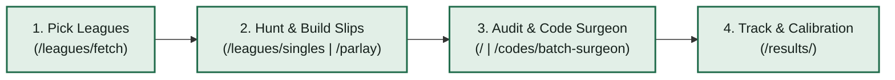
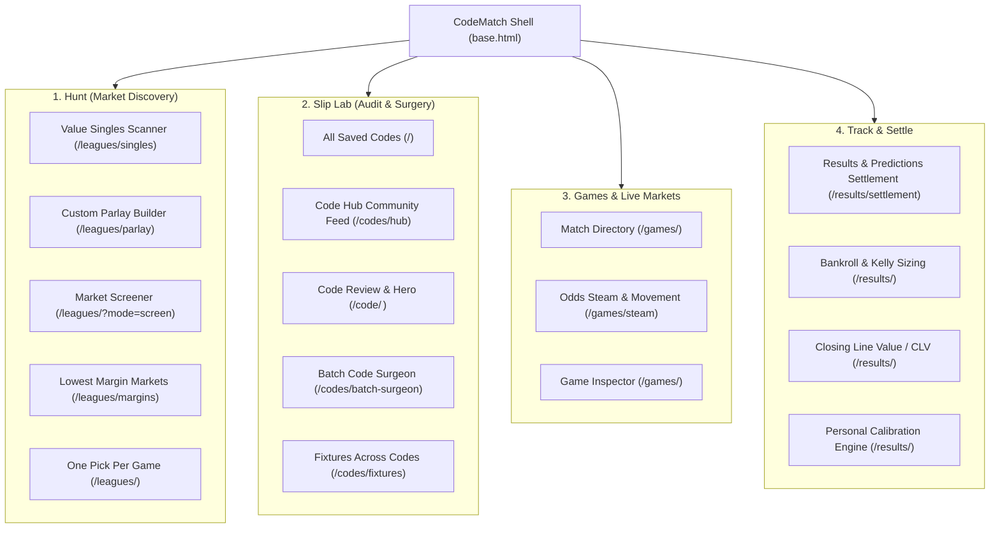
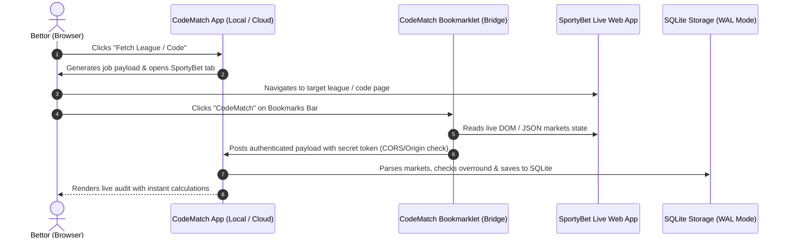

# CodeMatch Design System & Architectural Specification

> **Design Philosophy:** CodeMatch is an honest quantitative auditor for sports betting accumulators and value singles. Its single mission is to strip away bookmaker marketing and reveal what a bet really costs: exact compounded house edge, joint probabilities, and fair pricing. The visual language spends its boldness in one place — the **Chance Hero** on code reviews — while maintaining an institutional, distraction-free aesthetic: a calm pitch-green on chalk-white, tabular typography with right-aligned numbers, and visual hierarchy applied strictly to actionable decisions.

---

## 1. Information & Navigation Architecture

CodeMatch structures the entire betting journey around an intuitive, linear 4-stage pipeline:



### Site Hierarchy & Routing Map



### Modern Sidebar Navigation Architecture
Replacing crowded top horizontal navigation bars, CodeMatch uses an institutional, persistent **Left Sidebar Navigation** (`aside.cm-sidebar`):
- **Desktop ($\ge 900\text{px}$):** 250px fixed left panel with clear visual groupings (Hunt, Slip Lab, Games, Track & Settle, System), active left-border indicator, and integrated timezone / theme controls.
- **Mobile ($< 900\text{px}$):** Collapses into a sticky top bar with hamburger menu (`☰`), sliding out as a smooth off-canvas drawer with backdrop blur.

---

## 2. Client-Side Bookmaker Bridge Architecture

To guarantee 100% privacy and circumvent anti-bot IP blocks without fragile server-side scraping proxies, CodeMatch utilizes a sandboxed browser bookmarklet bridge:



---

## 3. Color Token System & Semantic Palette

All design tokens are defined on `:root` and automatically adapt between Light Mode (Chalk White) and Dark Mode (Night Pitch). Every combination passes **WCAG AA (4.5:1)** with primary reading text exceeding **WCAG AAA (7:1)**.

### Core Interface Tokens

| Token | Swatch | Light Hex | Dark Hex | RGB (Light) | Semantic Usage |
|---|:---:|---|---|---|---|
| `--paper` | ⬜ | `#f2f4f1` | `#121815` | `rgb(242, 244, 241)` | Canvas background (chalk white / pitch night) |
| `--surface` | ◽ | `#ffffff` | `#1a221e` | `rgb(255, 255, 255)` | Elevated cards, tables, forms, hero containers |
| `--ink` | ⬛ | `#16211c` | `#e6ebe7` | `rgb(22, 33, 28)` | Primary typography, active navigation pills |
| `--ink-2` | ◾ | `#4a5650` | `#a3aea8` | `rgb(74, 86, 80)` | Secondary labels, table headers, captions |
| `--rule` | ➖ | `#dde2dc` | `#2a3530` | `rgb(221, 226, 220)` | Structural borders, hairline dividers |
| `--accent` | 🟩 | `#1f6b4a` | `#6fcf9f` | `rgb(31, 107, 74)` | Brand primary, action buttons, win indicators |
| `--accent-soft` | 🟢 | `#e2efe7` | `#1f3a2d` | `rgb(226, 239, 231)` | Active state highlights, badge tints, hover states |
| `--sel` | 🟨 | `#f1e08a` | `#4a4220` | `rgb(241, 224, 138)` | Selected market row highlight (warm gold) |
| `--danger` | 🟥 | `#a33a2b` | `#f29a8c` | `rgb(163, 58, 43)` | Destructive actions, toxic accumulators, loss pills |

---

### Acca Toxicity Color Scale

The Toxicity Grade measures the compounded margin extracted by the bookmaker ($1 - \prod(1 - m_i)$):

| Grade | Margin Retained | Swatch | Badge Color (Light) | Badge Color (Dark) | Quantitative Meaning |
|:---:|:---:|:---:|---|---|---|
| **A** | $> 90\%$ | 🟢 | `#276c44` / `#e4f1e8` | `#7ed3a0` / `#1c3426` | **Elite / Ultra-Low Drag:** House margin $<10\%$. Sharp bettor standard. |
| **B** | $80\% - 90\%$ | 🟩 | `#2d8a56` / `#eaf5ee` | `#86dba6` / `#1e382b` | **Moderate Drag:** House margin $10\% - 20\%$. Acceptable 2–3 leg parlay. |
| **C** | $65\% - 80\%$ | 🟡 | `#b57a1e` / `#fef7e8` | `#e8b75c` / `#3a2f1b` | **High Drag:** House margin $20\% - 35\%$. Actionable candidates for Code Surgeon. |
| **D** | $45\% - 65\%$ | 🟠 | `#c24b2b` / `#fbeee9` | `#f58e7b` / `#42231c` | **Severe Drag:** House takes up to $55\%$ of wager value before kickoff. |
| **F** | $< 45\%$ | 🔴 | `#a33a2b` / `#f6e1dd` | `#f29a8c` / `#3d2420` | **Toxic:** House takes $>55\%$ margin. Severe negative expectation. |

---

### Odds Zone Palette

Odds zones provide an instant visual reference of implied probability:

| Zone | Odds Range | Implied Prob | Light Text / Bg | Dark Text / Bg | Description |
|---|:---:|:---:|---|---|---|
| **Very Short** | $< 1.10$ | $> 90.9\%$ | `#4a5650` / `none (border)` | `#a3aea8` / `none (border)` | Micro-yield, high tail risk |
| **Lower Risk** | $1.10 - 1.49$ | $67.1\% - 90.9\%$ | `#276c44` / `#e4f1e8` | `#7ed3a0` / `#1c3426` | Double chance, heavy favorites, Over 1.5 |
| **Medium** | $1.50 - 1.99$ | $50.3\% - 66.7\%$ | `#875709` / `#f7ecd6` | `#e8b75c` / `#3a2f1b` | Even-odds, BTTS, Draw No Bet |
| **Higher Risk**| $\ge 2.00$ | $< 50.0\%$ | `#a33a2b` / `#f6e1dd` | `#f29a8c` / `#3d2420` | Underdogs, outright draws, Asian lines |

---

### Settlement Status Badges

| Status | Badge Swatch | Color (Light) | Meaning |
|---|:---:|---|---|
| **Won** | 🟩 `✓ Won` | `#1f6b4a` / `#e2efe7` | Market criteria fulfilled in full-time/half-time scoreline |
| **Lost** | 🟥 `✗ Lost` | `#a33a2b` / `#f6e1dd` | Match score contradicted selection criteria |
| **Void / Push** | ⬜ `⚪ Void` | `#4a5650` / `#e8ece9` | Stake refunded (e.g. Draw No Bet on a draw, exact handicap push) |
| **Pending** | ⏳ `⏳ In Progress`| `#b57a1e` / `#fef7e8` | Match underway or waiting for final verified scoreline |

---

## 4. Visual Component Blueprints

### A. The 4-Step Pipeline Stepper
Renders at the top of every key page, providing orientation across the betting process:

```
┌────────────────────────────────────────────────────────────────────────────────────────┐
│  [✓ 1. Pick Leagues]  ───  [◉ 2. Hunt & Build]  ───  [3. Audit & Surgeon]  ───  [4. Track]  │
└────────────────────────────────────────────────────────────────────────────────────────┘
```

### B. The Chance Hero & Probability Dot Grid
The focal point of every code audit (`/code/<CODE>`):

```
┌────────────────────────────────────────────────────────────────────────────────────────┐
│  1 in 315                            ● ● ○ ○ ○ ○ ○ ○ ○ ○   Total Odds:       18.42     │
│  chance this code wins (0.32%)       ○ ○ ○ ○ ○ ○ ○ ○ ○ ○   Back per 1:       0.68      │
│                                      ○ ○ ○ ○ ○ ○ ○ ○ ○ ○   SportyBet keeps:  32%       │
│                                      ○ ○ ○ ○ ○ ○ ○ ○ ○ ○   Acca Toxicity:    Grade C   │
└────────────────────────────────────────────────────────────────────────────────────────┘
```
*(Only green filled dots represent winning permutations; 3 green dots out of 1,000 visually shocks the bettor out of taking irrational 15-leg accumulators).*

### C. Sticky Floating Booking Dock
Appears automatically at the bottom viewport when one or more selections are ticked:

```
┌────────────────────────────────────────────────────────────────────────────────────────┐
│  📦 4 selections ticked  │  Total Odds: 4.85  │  Chance: 1 in 5 (20.6%)  │  [Make Code ⚡] │
└────────────────────────────────────────────────────────────────────────────────────────┘
```

### D. Batch Code Surgeon Card
Surfaces before-and-after metrics in a single view:

```
┌────────────────────────────────────────────────────────────────────────────────────────┐
│  ⚡ Code: 40JGEB  │  Original: 6 Legs (Grade F)  ──→  Surgically Cured: 4 Legs (Grade B)│
│  Odds: 14.50 → 4.20  │  Win Chance: 2.1% → 23.8% (+1,033% boost)  │  [Dispatch Code ⚡] │
└────────────────────────────────────────────────────────────────────────────────────────┘
```

---

## 5. Typography Specification

* **Primary Heading Typeface:** `Bricolage Grotesque` (Weights: 500, 650, 800) — Wide, characterful numerals and clear editorial authority.
* **Interface & Data Typeface:** `Public Sans` (Weights: 400, 500, 700) with `font-variant-numeric: tabular-nums` to guarantee odds and prices align vertically down tables.
* **Type Scale:**
  - Hero Chance: `44px - 72px` (fluid clamp)
  - Page Title (`h1`): `34px` (desktop), `27px` (mobile)
  - Section Headings (`h2`): `21px`
  - Subheadings (`h3`): `16px`
  - Body Text: `15px` (line-height: `1.5`, max line length $\le 78$ characters)
  - Tabular & Figures: `14px`
  - Badges & Footers: `12px - 13px`
Right: a field of dots, one filled dot per expected win, out of 100 plays above 1% or out of 1 ÷ chance plays below it
(up to 1,000 dots). Below: total odds, what comes back on average per 1 staked, what SportyBet keeps, and fair odds, as
a figures strip. The filled dots pop in once when the page opens; that is the page's only automatic motion, and it's
skipped when the device asks for reduced motion.

## Components

| Component | Class | Where |
|---|---|---|
| Sidebar Shell | `aside.cm-sidebar` | persistent 250px left navigation shell (Hunt, Slip Lab, Games, Track & Settle, System) |
| Mobile Top Bar | `.mobile-header` > `.mobile-toggle` | mobile viewports (<900px): top brand bar with off-canvas hamburger toggle |
| Flow Stepper | `.flow-tracker` > `.flow-step` | top of core pages: 4-step betting pipeline with clickable stage jumps |
| Floating Booking Dock | `.floating-dock` | docks to screen bottom when ≥1 leg is ticked: live stats & 1-click booking dispatch |
| Strategy Cards | `.strategy-bar` > `.strategy-card` | Custom Parlay Builder: clear interactive cards for algorithmic parlay modes |
| League Box | `.league-filter-box` | clean scrollable container for selecting from 200+ imported leagues |
| Toxicity Badge | `.tox-badge` | Slip Lab & Batch Surgeon: Grades A through F indicating house margin drag |
| Figures strip | `.figures` > `.figure` | numbers in a row split by thin rules (not boxes): hero, results, raise-the-chance |
| Form box | `.card.filters` with `.row` | every filter and entry form |
| Table | `table` inside `.scroll` | everywhere; `.stack` to restack on phones |
| Selected row | `tr.sel` | the pick being looked at |
| Kicked-off row | `tr.past` | greyed text |
| Running totals | `.acc` | league picks: "a code of this pick and all above" |
| Total row | `tr.total` | the short-code builder |
| Collapsible row | `details.fixture` | fixtures across codes, other markets |
| Tabs | `.tabs` | market families on a game page |
| Message | `.msg.ok` / `.msg.bad` | results of an action; bad ones say what went wrong |
| Zone badge | `.zone.z-<key>` | next to every pick |
| Bet chooser | `.bet-group` chips, `details.other-bets` with `.bet-find` | the screener's bet types by category; other markets searchable |
| Main goal row | `.row.goal` | the one tinted form row: "highest-chance selections for total odds of at least…" |
| Odds check | `.odds-check` | under a make-code button once the code is made: odds then → now, picks gone; arrows are neutral, since longer odds aren't better value |
| Fetch box | `details.snippet` | "Fetch with the CodeMatch button", live status while it runs, the console code folded underneath as a fallback |
| CodeMatch button | `.bookmark` | the draggable bookmark on Import |
| Start-here checklist | `ol.start` | empty Codes page; steps tick off as they're done |
| Best right now | `section.best` > `.best-grid` | top of Codes: best open codes by back per 1, best code built from shared fixtures; accent rule on the left |
| Add-codes tabs | `.add-codes` with `.tab` buttons | Code Hub and Paste codes in one box; the last tab used is remembered in the browser |
| Field grid | `.field-grid`, `.pair` | forms with several labelled fields; labels above inputs, wraps by width |
| Explanation fold | `details.explain` | long "how this works" text kept one click away so the tools stay near the top |
| Codes grid on phones | `table.codes` | each saved code as a small grid: figures three across, weakest leg and kick-offs below |
| Sparkline | `svg.spark` | a pick's odds over time, drawn as steps |
| Buttons | `button`, `.secondary`, `.danger`, `.link` | main action, other actions, deleting, small text actions |

Numbered markers are used only where the content really is a sequence: the button set-up steps, the console steps
and the start-here checklist.

On sportybet.com the bookmark shows a small dark box in the bottom-right corner (ink background, paper text) with its
progress ("3 of 20: Premier League") and the result, then removes itself.

## Wording

* Plain words: "chance" not "implied probability", "back per 1 staked" not "expected value", "SportyBet keeps" not
  "overround", "1 in 315" rather than "0.32%" for small chances.
* Every number from SportyBet is labelled as theirs. The app describes; it never tells you a pick is good.
* A chance SportyBet's data doesn't support reads "not given", never a guess. A code's chance is called an estimate.
* Buttons say what happens: "Prepare the fetch", "Fetch with the CodeMatch button", "Record the bet", "Delete ticked".
* Empty pages say what to do next; error messages say what went wrong and how to fix it.
* Odds to two decimals, chances as whole percentages (one decimal in tables), returns to three decimals.
* Times are written in UTC (Ghana time); the footer switch shows them in the device's own time zone instead.
